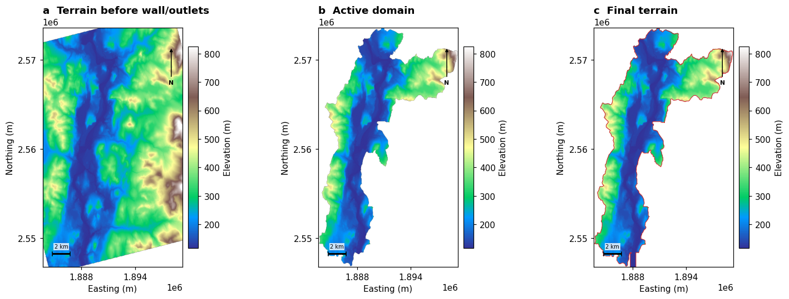

# RIFT Input Builder — WW_RIFT

[](https://github.com/Nishat1728/WW_RIFT/actions/workflows/ci.yml)
[](LICENSE)

A notebook-led, raw-first Python workflow for preparing quality-controlled inputs for **RIFT**.
Choose a study area and data sources in graphical controls; source managers download products,
preserve raw files, check them, and prepare the grids and forcing the solver reads.

RIFT Input Builder prepares simulation-ready inputs for RIFT using
[Watershed Workflow](https://github.com/environmental-modeling-workflows/watershed-workflow) and other
data-source adapters. The notebook provides a simple interface for selecting sources,
downloading data, and checking the resulting inputs.



## Start here

- [Beginner installation and step-by-step guide](docs/GETTING_STARTED.md)
- [General notebook](RIFT_Input_Builder.ipynb) — HUC, polygon or rectangle; not basin-specific
- [Prefilled HUC12 demo](examples/HUC12_Demo.ipynb) — a small, event-only first run
- [Spin-up + transient guide](docs/SPINUP_AND_TRANSIENT.md) — two configurations, historical low flows and output controls
- [Sources, credentials and limitations](docs/RIFT_INPUT_SOURCE_CATALOG.md)

Download or clone the **complete repository**, not just the notebook. Install its environment,
launch JupyterLab, select the environment's kernel, then run the cells from top to bottom.

```bash
git clone https://github.com/Nishat1728/WW_RIFT.git
cd WW_RIFT
conda env create -f environment.yml
conda activate riftprep
jupyter lab RIFT_Input_Builder.ipynb
```

The environment targets scientific Python on Linux; the beginner guide covers platform caveats,
optional sources, the Linux lock file and troubleshooting. A GPU is **not** needed for input
preparation. The separate RIFT-UConn solver requires its Linux/CUDA/GPU installation.

## Inputs and sources

| Input | Executable choices |
|---|---|
| Study area | USGS HUC, local polygon, coordinate rectangle |
| Elevation | USGS 3DEP 10/30 m, Copernicus GLO-30, local raster |
| River geometry | USGS 3DHP, local flowlines; confirmed empty geometry is valid |
| Land properties | NLCD cover/impervious/canopy, local rasters |
| Soil | SSURGO, SoilGrids, local properties |
| Rainfall | AORC, Daymet, MRMS, ERA5-Land, local NetCDF |
| Event inflows and coastal stage | Explicit USGS gauges and boundary placement |
| Spin-up baseflow | Historical USGS daily-mean discharge quantile, or explicit user constants |
| Initial depth, outlets, drainage | User definitions/files and documented derived alternatives |

Availability, geography, time coverage, credentials and temporal assumptions vary by source.
See the source catalog. Source DEM resolution and **final RIFT grid cell size are separate
choices**: select a 30 m grid for a 30 m simulation. Projection/resampling is recorded.

## Spin-up and transient

The general notebook asks for both phases' dates, save frequencies and hotstart choices.
With spin-up enabled it prepares:

- `rift_spinup.cfg`: default **four calendar months**, **no rainfall**, constant baseflow
  hydrographs, **daily outputs**, **hotstart ON**.
- `rift_case.cfg`: event/transient run, matching rainfall dates by default.
  Output frequency and hotstart saving are independently configurable; hotstart defaults ON.

Select inlet gauges to derive baseflow from the preceding **20 years**. The default quantile is
**0 (minimum valid daily mean)**; choose any non-exceedance quantile from 0 to 1 instead.
Missing days are not filled, real zeros remain zero, and coverage is reported (default gate 90%).
This is a low-flow proxy, **not guaranteed perennial flow**, groundwater-baseflow separation or
an ungauged discharge estimate. No gauge or manual flow is selected on your behalf.

The generated `RUN.md` explains `riftprep simulate-stages`. The event uses **`restart.hotstart`**
from the exact spin-up end, retaining momentum, infiltration history, soil saturation and urban
storage without interpolation. The solver clock continues; a forcing-origin offset aligns all
event inputs without modifying their files. Event diagnostic statistics are reset, not physical state.
This requires the supplied [RIFT-UConn restart integration](integrations/rift_uconn/README.md);
unpatched solvers and incomplete/legacy checkpoints are rejected. Periodic hotstarts remain
optional, but a final spin-up checkpoint is mandatory. Preparation does not execute or equilibrate the model.

## Raw-first workflow and quality control

```text
Choose → save provider responses → native checks → processing/alignment → final checks
       → product maps, forcing files, provenance and RIFT configurations
```

Each case owns its data separately:

```text
my_case/
  raw/                  # immutable provider responses/local source copies; checksummed
  processed/            # transformations and intermediate grids
  simulation_ready/     # files consumed by RIFT
  figures/              # native and final-product maps
  quality_control/      # coverage, corrections, timings and provenance
  rift_spinup.cfg       # when enabled
  rift_case.cfg
  simulation_plan.json  # phase windows and explicit runtime dependency
  RUN.md
```

`fresh` is the default: it downloads again and clears only the selected, package-marked case.
`reuse` remains an explicit alternative. Never select a case to preserve in fresh mode.
Raw products are not changed by resampling or corrections.

Land/soil gaps and unsupported cover classes are mapped before user-defined replacement.
Processed canopy/impervious values above 100 are reported, mapped and capped; raw NLCD stays
unchanged. Rainfall nulls follow the visible zero-replacement policy, with counts recorded.
These policies do not make inappropriate sources or unreviewed boundaries scientifically valid.

Read [DEM preservation](docs/DEM_PRESERVATION.md), [directory ownership](docs/DIRECTORY_CONTRACT.md),
[raw provenance](docs/PROVENANCE_CONTRACT.md), and [run manifests](docs/RUN_PROVENANCE_MANIFEST.md).

## Examples and testing

The [HUC12 demo](examples/HUC12_Demo.ipynb) uses fresh public U.S. inputs, a nominal 30 m USGS DEM
and a 30 m RIFT grid for a 48-hour event. It deliberately has spin-up and optional boundaries
disabled: no upstream gauge is assumed. Enable spin-up with appropriate gauges or constants
for a two-stage case. Example maps and a validation receipt are in `examples/`; downloaded
forcing and simulation outputs are not included.

```bash
python -m pip install -e ".[test,notebook]"
python -m pytest -q
python tools/build_general_notebook.py
```

CI runs offline unit/fixture integration tests on Python 3.11 and 3.12, including two-phase CFGs,
quantiles, raw preservation, complete-state binary I/O and failure gates. A
[synthetic GPU restart check](examples/complete_restart_validation.json) passed with identical
split/uninterrupted results in 17 checked fields; this is not a full four-month basin run.
Network tests are opt-in:
`python -m hpc.validate_spinup_history /new/test/directory` downloads a 20-year gauge record.
It does not run the GPU solver. Provider outages and full GPU simulations need separate checks.

## Contributing and acknowledgements

Read [CONTRIBUTING.md](CONTRIBUTING.md). Include reproducible small tests; never commit credentials,
personal HPC paths, downloaded forcing or large outputs. For scientific use, report providers,
product versions, QC decisions, the code commit and provenance manifest. Cite the source datasets
and Watershed Workflow where used; this repository does not replace their license/citation terms.

Released under [BSD-3-Clause](LICENSE). See the
[upstream Watershed Workflow project](https://github.com/environmental-modeling-workflows/watershed-workflow)
for its documentation, examples and citation information.
